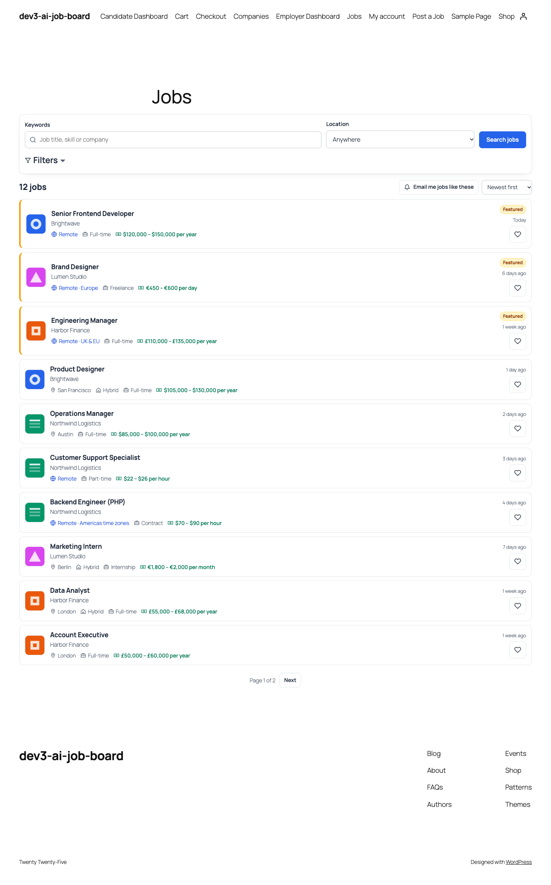

# DEV3 AI Job Board & Resume Matcher for WordPress

A complete job board with front-end submission, paid packages, employer and candidate dashboards, and DEV3 AI resume parsing and match scores.



## Features

DEV3 AI Job Board & Resume Matcher turns WordPress into a job board or a careers site.

**Job board**

* Jobs with companies, categories, job types, locations, skills, workplace (on-site, hybrid, remote) and salary ranges.
* Search with keyword, location, category, type, workplace, minimum salary and "date posted" filters; AJAX results with shareable URLs; featured jobs first.
* Single job pages with an apply box, company box and similar jobs; company pages with all open jobs.
* Google for Jobs: JobPosting structured data on every live job.
* Job alerts: daily or weekly emails for saved searches (guests confirm by email).

**Employers**

* Front-end "Post a job" wizard: details, preview, package, checkout.
* Packages with job credits, duration and featured placement. Pay by Stripe Checkout, WooCommerce (HPOS and block checkout compatible) or offline.
* Employer dashboard: jobs (edit, mark filled, relist), companies, packages and payments.
* Applications pipeline: a kanban board (drag and drop, or "Move to" on any device) that becomes a list on phones, with notes, ratings and optional emails to candidates.

**Candidates**

* Candidate dashboard: profile, applications with clear status, saved jobs, job alerts and recommended jobs.
* Resume upload (PDF, Word or text) stored privately: never reachable by URL, only by the candidate, the employers they apply to and site managers.

**DEV3 AI (optional, uses your own Google AI API key)**

* Job description writer with tone presets, and an inclusive-language check.
* Resume parsing: a resume becomes a structured profile that the candidate reviews before saving.
* Match scores with explanations (skills, experience, role and location fit, strengths and gaps), shown to employers as decision support only.
* Everything works without AI: rule-based outlines, a built-in resume reader and transparent rule-based scores.

**Fairness**

Matching never uses names, contact details, photos, age or date of birth, gender, marital or family status, nationality, ethnicity, religion, disability, health, sexual orientation, union membership, political views or street addresses. These are removed before scoring and never sent to AI. A score never moves, hides or rejects a candidate.

**Privacy**

AI features send data to Google AI only when you add an API key. The plugin adds text to your privacy policy, and supports the WordPress personal data exporter and eraser.

## Requirements

- WordPress 6.0 or newer (tested up to 6.8)
- PHP 7.4 or newer
- Optional: your own Google AI API key (from Google AI Studio) to switch on the DEV3 AI features. The rest of the plugin works without one.

## Installation

### From the release zip

1. Download `dev3-ai-job-board.zip` from the [latest release](https://github.com/dev3tech/dev3-ai-job-board/releases/latest).
2. In WordPress, go to **Plugins → Add New → Upload Plugin**, choose the zip and click **Install Now**.
3. Click **Activate**.

### Build from source

```bash
git clone https://github.com/dev3tech/dev3-ai-job-board.git
cd dev3-ai-job-board
composer install --no-dev
npm ci
npm run build
```

Then copy the `dev3-ai-job-board` folder into `wp-content/plugins/` and activate it.

### Getting started

1. Upload the plugin zip in Plugins > Add New > Upload, then activate it.
2. The plugin creates five pages: Jobs, Post a Job, Employer Dashboard, Candidate Dashboard and Companies.
3. Open DEV3 AI Job Board > Settings to review pages, moderation and emails.
4. Optional: add a Google AI API key in DEV3 AI Job Board > API Config.
5. Optional: set up packages and a payment gateway in Packages & payments.

## FAQ

### Do I need an AI key?
No. Every feature works without AI. The key adds AI writing, AI resume parsing and explained scores.

### Can guests apply?
Yes, if "Allow applying without an account" is on. Logged-in candidates apply in one click with their profile.

### Where are resumes stored?
In wp-content/uploads/dev3jb-private with deny rules and random names. On Nginx, add `location ~* /uploads/dev3jb-private/ { deny all; }`.

### Does it work with my theme?
It inherits your theme's fonts and works with block themes (Twenty Twenty-Five) and classic themes (Twenty Twenty-One). Use the blocks or shortcodes on any page.

## Documentation

The full HTML guide (installation, settings, hooks and FAQ) is in [`docs/index.html`](docs/index.html). Open it in a browser after cloning or downloading the repository.

## Changelog

### 1.0.0
* Initial release.

## Licence

Released under the GNU General Public License v2.0 or later (GPL-2.0-or-later). See [LICENSE](LICENSE).

## More from DEV3

- [DEV3 AI Job Board & Resume Matcher for WordPress on the DEV3 Marketplace](https://www.dev3.tech/item/dev3-ai-job-board)
- [More WordPress plugins, themes and templates from DEV3](https://www.dev3.tech/marketplace)
